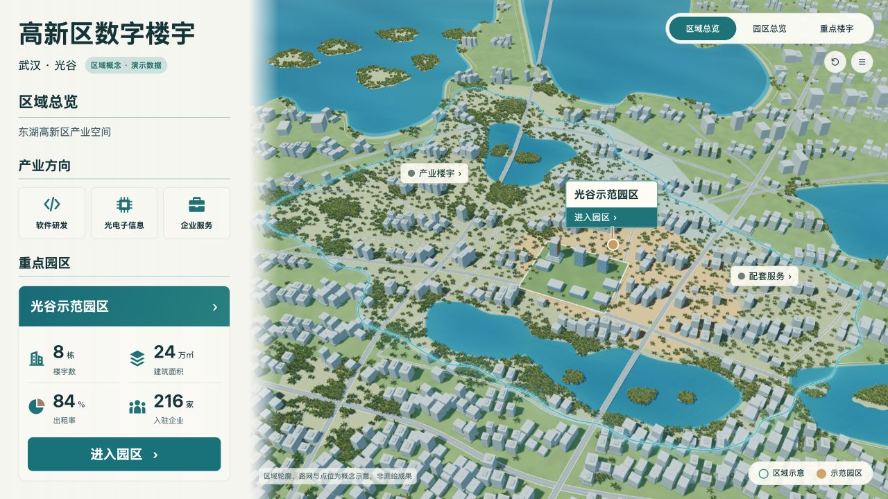
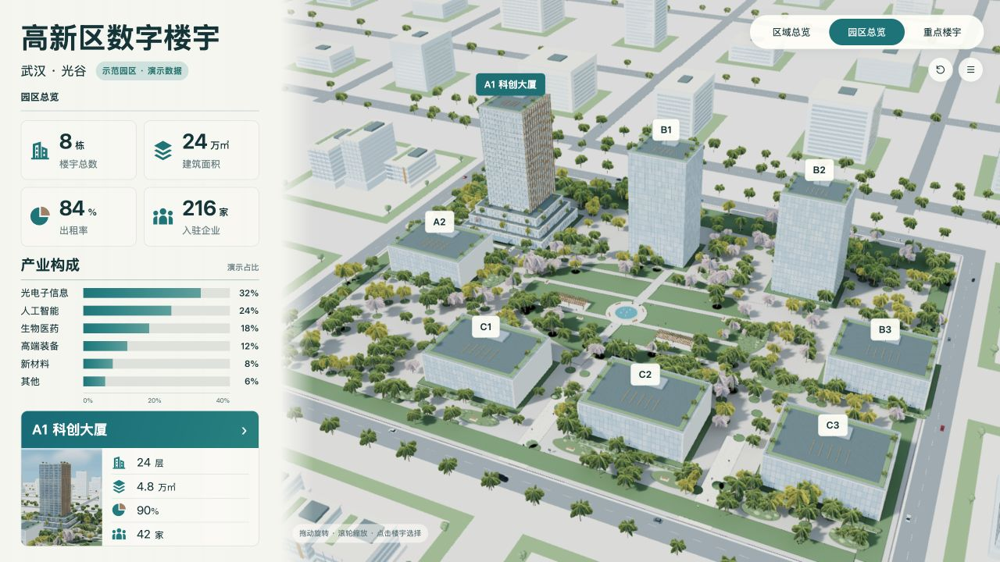
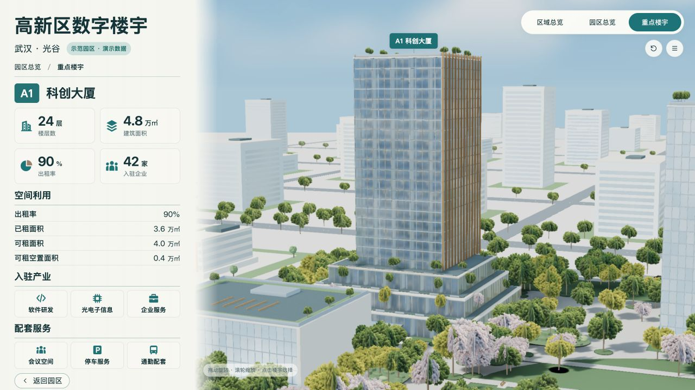
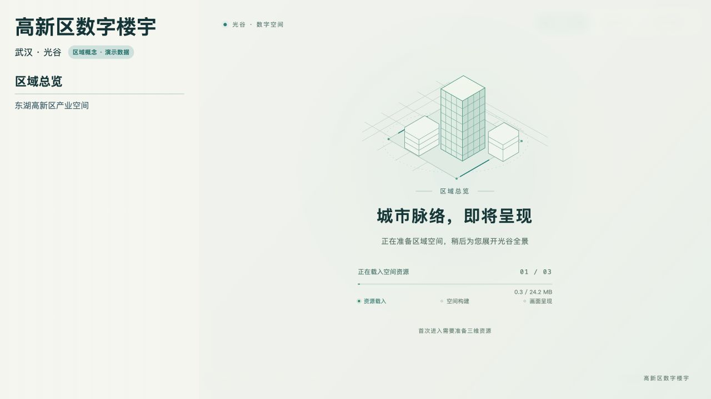
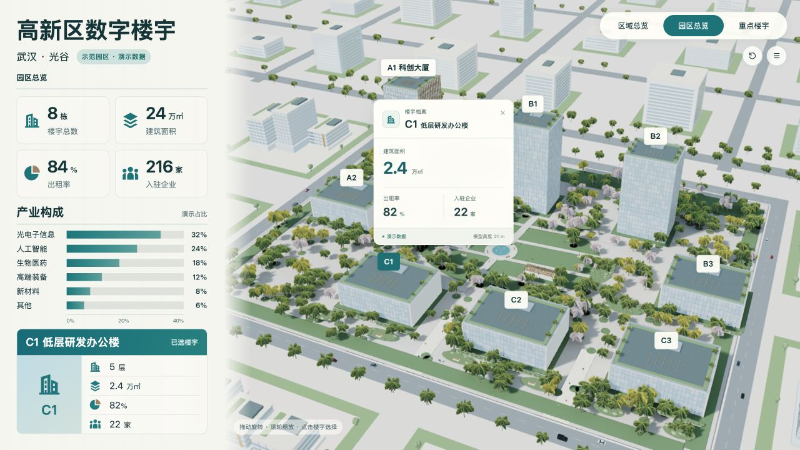

# Urban Building Dashboard · 城市楼宇三维大屏

以武汉光谷为产业背景，使用 Vue 3、Three.js 与 Blender MCP 制作的三维空间展示：城市区域 → 示范园区 → A1 科创大厦。

**[在线体验 →](https://urban-building-dashboard.vercel.app/)** · [本地运行](#本地运行) · [项目结构](#项目结构)

> 园区、建筑、坐标与经营指标均为演示设定；城市区域为概念示意，不是测绘成果或真实运营数据。

## 设计效果图

以下为已确认的 **AI 设计终稿与视觉目标**。当前实时页面的写实程度仍有差异，实际运行画面在下一节单独展示；详见 [实现状态](docs/implementation-status.md)。


<details>
<summary>查看区域总览与重点楼宇的 AI 设计终稿</summary>

| 区域总览 · 设计目标 | 重点楼宇 · 设计目标 |
| --- | --- |
|  |  |

三张唯一有效终稿及确认记录见 [design/final](design/final/README.md)。

</details>

## 实际运行效果

以下图片均来自当前代码在真实浏览器中的运行页面，使用同一演示规划。点击图片可查看完整画面。

| 区域总览 | 园区总览 | 重点楼宇 |
| --- | --- | --- |
| [](docs/images/city.jpg) | [](docs/images/campus.jpg) | [](docs/images/building.jpg) |
| 区域边界、路网水系与园区入口 | 楼宇分布、产业构成与经营摘要 | A1 建筑细节与空间利用 |

### 加载与对象联动

| 资源准备 | 楼宇选择 |
| --- | --- |
| [](docs/images/loading.jpg) | [](docs/images/interaction.jpg) |
| 建筑线稿动效、真实下载量与三阶段反馈 | 同一楼宇身份同步浮卡、摘要与指标 |

加载截图通过本地限速的真实资源请求采集。下载完成后继续构建空间，首帧画面就绪再淡出；失败时提供重试入口。园区摘要中的 A1 缩略图展示完整楼顶与裙房。

## 交互体验

- **城市区域**：连续城市环境、湖泊、道路和带柔光的区域边界；产业楼宇与配套服务可点击查看。
- **示范园区**：八栋楼宇、喷泉、廊架、座椅、行人与混合树种；六项产业构成横向柱状图。
- **楼宇选择**：浮卡与左侧摘要同步面积、出租率和入驻企业；选择其他楼宇保持相机，A1 可进入近景。
- **空间切换**：城市入场描边、城市到园区的连续镜头、楼宇近景与返回；支持旋转、缩放、复位和巡览。
- **资源加载**：轻量建筑线稿动效；按真实字节显示下载进度，区分资源载入、空间构建与首帧准备，支持失败恢复和减弱动效。
- **动态细节**：黑白红灰轿车、SUV、货车沿道路行驶；喷泉水流持续运动；信息卡按对象位置避让。
- **数据状态**：同一规划源驱动模型身份与指标，演示和无数据状态分别呈现。

## 本地运行

Node.js 20.20.2、npm 10.8.2；依赖由根目录 `package-lock.json` 锁定。

```sh
git clone https://github.com/Xxcool/urban-building-dashboard.git
cd urban-building-dashboard
npm ci
npm run dev
```

打开终端显示的 HTTP 地址。模型和贴图随源码提供，运行网页无需安装 Blender 或配置 API 密钥。

```sh
npm test
npm run format:check
npm run build
npm run preview -- --port 4175
```

## Blender MCP 与烘焙

`planning/project.json` 是工程参数和演示数据的唯一来源。三维制作使用真实 Blender MCP，保留打包 `.blend` 工程、MCP 操作记录和导出清单。

- 园区：地面颜色与静态光照烘焙；A1、裙房及静态设施的 UV2 AO 和间接光。
- 城市：静态地表 AO、湖岸和地表色调；树冠共用透明材质图集。
- 车辆、人物和喷泉保持实时运动。园区总览与 A1 近景分配不同渲染细节。
- 实际 GLB 约为园区 **18.6 MB**、城市 **24.2 MB**，按层级加载；园区和楼宇共用同一模型。

日常前端开发直接使用仓库内的现有资产，无需重复执行目录迁移脚本。`scripts/migrate_asset_paths.py --previous-planning <旧规划文件>` 仅用于本次 `app/public` 到 `public` 的一次性迁移，拒绝模型或业务规划变化。

加载已保存工程、通过 MCP 再导出与独立目录重建的方法见 [制作与复验记录](docs/restoration-v27.md)。历史操作记录表达各次修改上下文，不应对任意当前场景直接重放。

## 项目结构

```text
src/App.vue           Vue 单文件根组件与三层展示协调
src/components/       图标、经营摘要等界面组件
src/scenes/           Three.js 容器、入场与场景运动
src/composables/      Vue 组合式逻辑
src/data/             同一规划快照与数值口径
src/utils/            浮卡布局等纯计算工具
src/styles/           展示样式
public/assets/        网页运行模型、贴图与派生配置
tests/                前端契约测试
planning/             统一规划源
assets/               打包 Blender 工程、材质、MCP 操作和导出清单
design/final/         唯一有效的三场景设计终稿
docs/images/          README 使用的实际网页截图
docs/                 当前规格、实现说明与历史记录
scripts/              配置派生、MCP 通信、核对及重建工具
checks/               实际对照、交互、性能与重建证据
```

前端直接在仓库根目录开发和构建，使用 Vue 3 单文件组件与 Vite 的 Vue 插件。编辑器建议安装 Vue - Official 扩展；格式化使用 `npm run format`。

线上站点使用 Vercel：项目 Root Directory 设为仓库根目录（留空），构建命令为 `npm run build`，输出目录为 `dist`。当前项目的平台根目录设置已同步为仓库根目录。仓库中的 CI 只执行验证。

## 验证

包含前端契约测试、道路避水与景观净空检查、模型对象和楼层绑定检查、实际浏览器交互与重复切层检查，以及独立目录通过 MCP 重导两份工程并重建网页。

[当前实现状态](docs/implementation-status.md) · [逐项修正与验证](docs/restoration-v27.md) · [终稿与实际对照](checks/v27-comparison.html)

当前为演示项目；目标展厅硬件、长时运行、完整跨浏览器矩阵与真实接口接入未验证。依赖与第三方声明见 [THIRD_PARTY_NOTICES.txt](THIRD_PARTY_NOTICES.txt)。

---

## 👨‍💻 作者 (Author)

- **Xxcool** - [GitHub (@Xxcool)](https://github.com/Xxcool) · [掘金技术主页](https://juejin.cn/user/4265760845468296/posts)

---

## 📄 开源许可 (License)

本项目遵循 [MIT License](LICENSE) 开源协议。


