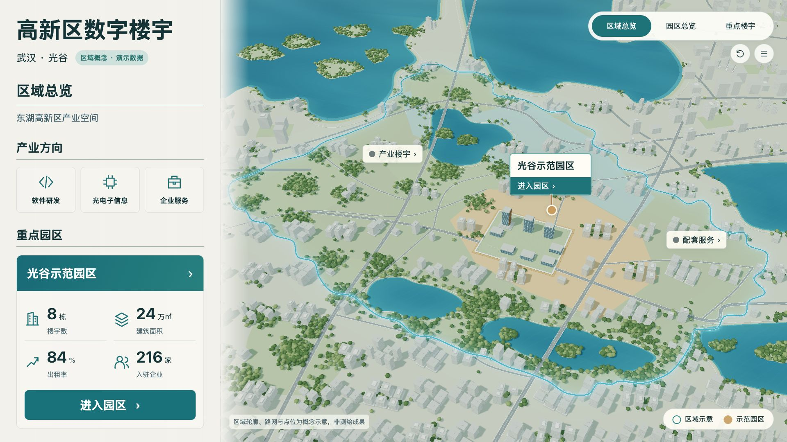
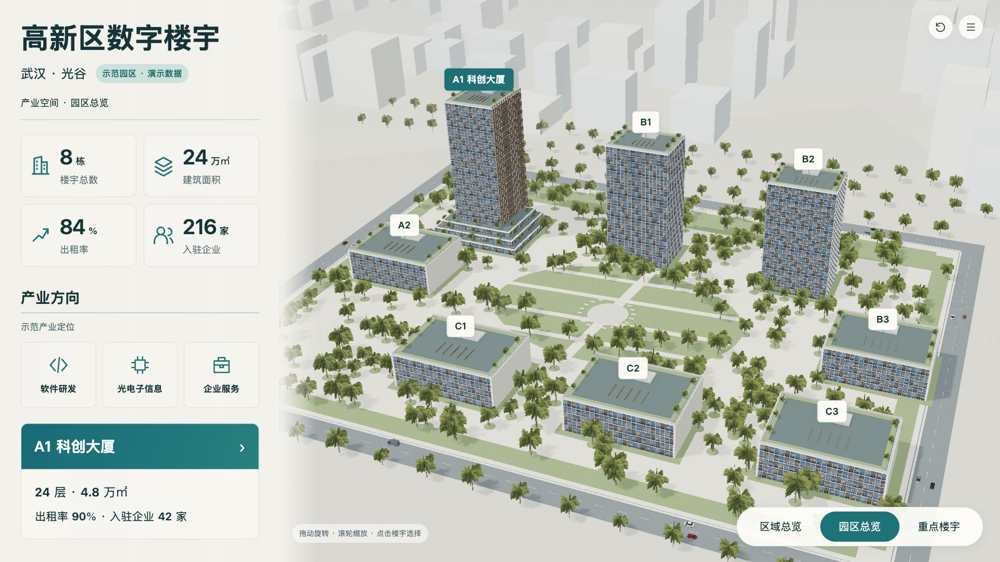
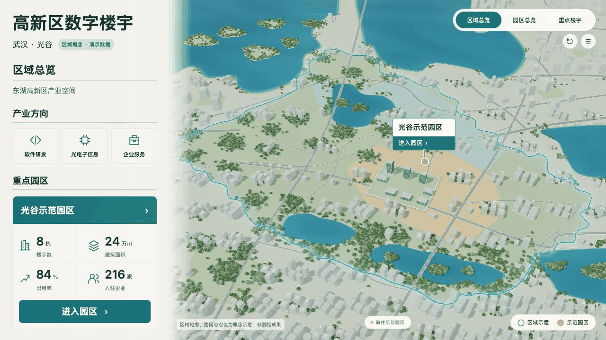

# Urban Building Dashboard · 城市楼宇三维大屏

以武汉光谷为产业背景的三维楼宇展示项目，使用 Vue 3、Three.js 与 Blender，提供城市区域、示范园区和重点楼宇三个层级的空间浏览与数据联动。

> 本项目为可运行的演示评审版。园区、建筑、坐标与经营指标均为演示设定，城市区域为概念示意，不是实际测绘结果或真实运营数据。



**[在线预览 →](https://xxcool.github.io/urban-building-dashboard/)**

## 交互体验

- **城市区域**：连续城市环境、湖泊与道路、区域边界和示范园区定位；产业楼宇与配套服务支持点击查看。
- **示范园区**：八栋楼宇的选择、高亮与信息卡；左侧面板同步展示当前楼宇的面积、出租率和入驻企业等演示指标。
- **重点楼宇**：进入 A1 科创大厦，查看空间利用信息并返回园区。
- **镜头与动效**：旋转、缩放、复位、巡览、全屏，以及城市进入园区的连续动画。首次约 2.8 秒、再次约 1.1 秒，支持手势中断、资源等待和失败重试。
- **交通与卡片**：黑白红灰轿车、SUV、轻型货车沿道路运动；信息卡根据对象投影位置避让界面和遮挡。



<details>
<summary>查看进入园区动效实拍（GIF）</summary>



GIF 为实际页面采样，实时流畅度请以本地运行效果为准。

</details>

## 本地运行

已验证工具链：Node.js 20.20.2、npm 10.8.2，依赖版本由 `app/package-lock.json` 锁定。

```sh
git clone https://github.com/Xxcool/urban-building-dashboard.git
cd urban-building-dashboard/app
npm ci
npm run dev
```

打开终端显示的本地地址。模型和贴图随源码提供，不需要先安装 Blender。请通过 HTTP 服务运行，不能直接双击 HTML。

生产构建与预览：

```sh
cd app
npm test
npm run build
npm run preview -- --port 4175
```

仓库不提交 `node_modules`、`dist` 和 `work`。历史评审文档提到的本机路径与旧生产构建属于开发过程记录；新克隆请使用上述命令。

## 规划与模型重建

`planning/project.json` 是统一规划入口。模型、相机、对象身份和经营指标从规划源派生；不要手动修改生成的 GLB 或 `runtime.json`。模型与网页配置包含哈希校验，避免版本混用。

完整重建需要 Python 3 与 Blender。已验证 Blender 5.2.2 LTS；以下示例为 macOS，其他系统通过 `--blender` 指定可执行文件：

```sh
python3 scripts/rebuild.py \
  --dest work/fresh-build \
  --cache work/npm-cache \
  --blender /Applications/Blender.app/Contents/MacOS/Blender \
  --report checks/my-rebuild.json
```

目标目录必须尚不存在。脚本从源码、规划与固定图片输入重新生成模型和配置，安装依赖、运行检查并构建页面，再比对模型及配置哈希。Blender 请在正常本机终端中运行。

概念图、整屏稿和 AI 生成材质作为固定输入保留，重建无需调用生图服务或提供 API 密钥。

## 项目结构

```text
app/         Vue + Three.js 前端、测试与运行资产
planning/    统一规划源
scripts/   模型生成、配置派生、验证与重建脚本
assets/      Blender 工程及模型清单
design/      概念图、整屏稿、材质和生成记录
docs/        制作规格、迭代与确认记录
checks/      实际截图、对照、测试和重建证据
```

## 验证与当前边界

v22 已通过 14 项 Node 测试、3 项道路边界测试及独立目录完整重建；执行过 12 轮城市、园区和 A1 往返验证，以及实际加载延迟和失败重试检查。

- [v22 实现与复核记录](docs/iteration-v22.md)
- [最终重建结果](checks/rebuild-v22-final.json)
- [浏览器运行验证](checks/entry-runtime-v22.json)
- [原始评审说明与历史入口](docs/README-review-v22.md)

当前城市建筑、街区和湖岸水面的写实程度仍与 AI 概念图有差异（R-05-REALISM），尚未作为最终视觉验收。目标展厅硬件、长时运行、完整跨浏览器矩阵和真实接口未验证。

依赖与第三方声明见 [THIRD_PARTY_NOTICES.txt](THIRD_PARTY_NOTICES.txt)。

## GitHub Pages

推送至 `main` 后，GitHub Actions 自动执行依赖安装、测试、生产构建与 Pages 部署。站点从 `app/dist` 发布，使用相对资源路径，兼容仓库子目录。无需在线运行 Blender；模型变更应先本地重建并提交更新后的资产与配置。
