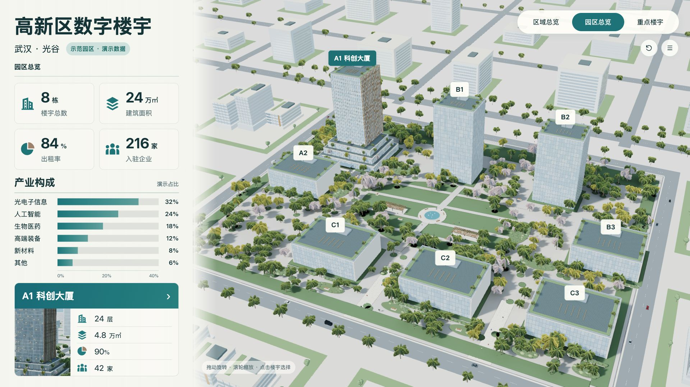
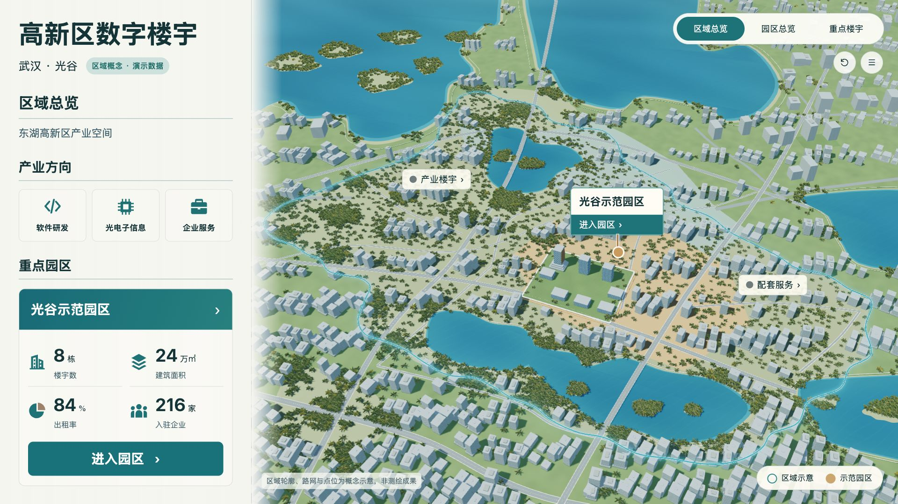
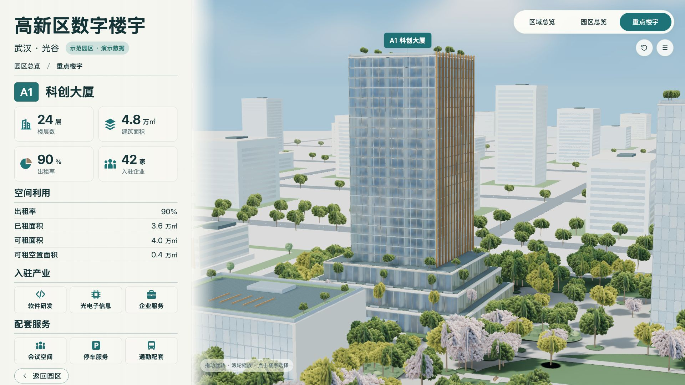

# Urban Building Dashboard · 城市楼宇三维大屏

以武汉光谷为产业背景，使用 Vue 3、Three.js 与 Blender MCP 制作的三维空间展示：城市区域 → 示范园区 → A1 科创大厦。

**[在线体验 →](https://urban-building-dashboard.vercel.app/)**

> 园区、建筑、坐标与经营指标均为演示设定；城市区域为概念示意，不是测绘成果或真实运营数据。

## 实际运行画面

下图来自实际浏览器中的交互三维页面。



<details>
<summary>城市区域与 A1 科创大厦</summary>





</details>

三张唯一有效的 AI 设计终稿保存在 [design/final](design/final/README.md)，与运行截图分开维护。实时模型保留可交互性与性能取舍，具体还原差异见 [实现状态](docs/implementation-status.md)。

## 交互体验

- **城市区域**：连续城市环境、湖泊、道路和带柔光的区域边界；产业楼宇与配套服务可点击查看。
- **示范园区**：八栋楼宇、喷泉、廊架、座椅、行人与混合树种；六项产业构成横向柱状图。
- **楼宇选择**：浮卡与左侧摘要同步面积、出租率和入驻企业；选择其他楼宇保持相机，A1 可进入近景。
- **空间切换**：城市入场描边、城市到园区的连续镜头、楼宇近景与返回；支持旋转、缩放、复位和巡览。
- **动态细节**：黑白红灰轿车、SUV、货车沿道路行驶；喷泉水流持续运动；信息卡按对象位置避让。
- **数据状态**：同一规划源驱动模型身份与指标，演示和无数据状态分别呈现。

## 本地运行

Node.js 20.20.2、npm 10.8.2；依赖由 `app/package-lock.json` 锁定。

```sh
git clone https://github.com/Xxcool/urban-building-dashboard.git
cd urban-building-dashboard/app
npm ci
npm run dev
```

打开终端显示的 HTTP 地址。模型和贴图随源码提供，运行网页无需安装 Blender 或配置 API 密钥。

```sh
npm test
npm run build
npm run preview -- --port 4175
```

## Blender MCP 与烘焙

`planning/project.json` 是工程参数和演示数据的唯一来源。三维制作使用真实 Blender MCP，保留打包 `.blend` 工程、MCP 操作记录和导出清单。

- 园区：地面颜色与静态光照烘焙；A1、裙房及静态设施的 UV2 AO 和间接光。
- 城市：静态地表 AO、湖岸和地表色调；树冠共用透明材质图集。
- 车辆、人物和喷泉保持实时运动。园区总览与 A1 近景分配不同渲染细节。
- 实际 GLB 约为园区 **18.6 MB**、城市 **24.2 MB**，按层级加载；园区和楼宇共用同一模型。

加载已保存工程、通过 MCP 再导出与独立目录重建的方法见 [制作与复验记录](docs/restoration-v27.md)。历史操作记录表达各次修改上下文，不应对任意当前场景直接重放。

## 项目结构

```text
app/                  Vue + Three.js 前端、测试和运行资产
planning/             统一规划源
assets/               打包 Blender 工程、材质、MCP 操作和导出清单
design/final/         唯一有效的三场景设计终稿
docs/images/          README 使用的实际网页截图
docs/                 当前规格、实现说明与历史记录
scripts/              配置派生、MCP 通信、核对及重建工具
checks/               实际对照、交互、性能与重建证据
```

## 验证

包含前端契约测试、道路避水与景观净空检查、模型对象和楼层绑定检查、实际浏览器交互与重复切层检查，以及独立目录通过 MCP 重导两份工程并重建网页。

[当前实现状态](docs/implementation-status.md) · [逐项修正与验证](docs/restoration-v27.md) · [终稿与实际对照](checks/v27-comparison.html)

当前为演示项目；目标展厅硬件、长时运行、完整跨浏览器矩阵与真实接口接入未验证。依赖与第三方声明见 [THIRD_PARTY_NOTICES.txt](THIRD_PARTY_NOTICES.txt)。
