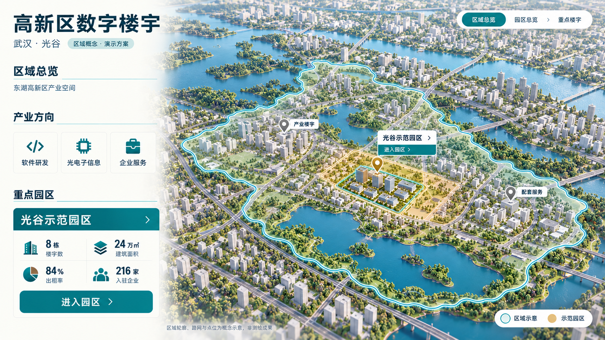
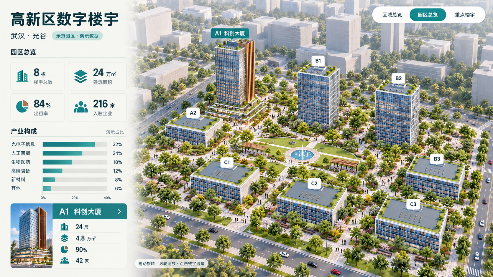
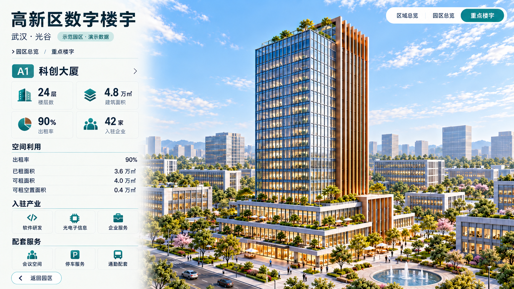

# 唯一有效的三场景设计终稿

用户已确认：**“确认，以这三张为终稿”**。分析、设计、建模、UI与README仅以本目录三张图为视觉依据；不要另找旧概念、参考截图或当前页面去反推设计。

| 场景 | 唯一终稿 | 必须保留的内容 |
| --- | --- | --- |
| 城市 | [city.png](city.png) | 连续城市与湖泊、完整南湖圈选、青蓝实线及柔和外晕、金色示范区 |
| 园区 | [campus.png](campus.png) | 八栋身份、六项横向产业构成图、实心图标、景观与A1摘要 |
| 楼宇 | [building.png](building.png) | 同一A1、空间利用、入驻产业、配套服务与圆形水景 |

共同规范：暖白面板、青绿强调、柔和日光；右上三层导航；KPI使用实心楼宇/层叠面积/饼扇符号/人群图标。园区柱图32/24/18/12/8/6%为演示构成，0–40%共同标尺；当前页面缺失项须按图补齐，不退回分类卡片。

图像是AI设计资产，不是网页截图。A1的24层（3层裙房+21层塔楼）及经营数值以唯一规划源为工程契约；不能用AI可数窗格代替层数。无数据态沿用同层终稿布局，只替换数据，不另设旧版图稿。

[确认记录](approval.md) · [固定文件哈希](manifest.json) · [生成审计](generation.json) · [实现差异](../../docs/implementation-status.md)

生产依赖贴图单独放在 ../../assets/materials/，它们不是视觉方向参考。旧稿、参考图、旧状态稿均已移出有效目录。
