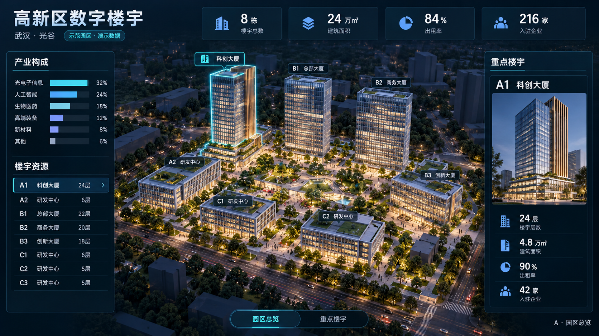
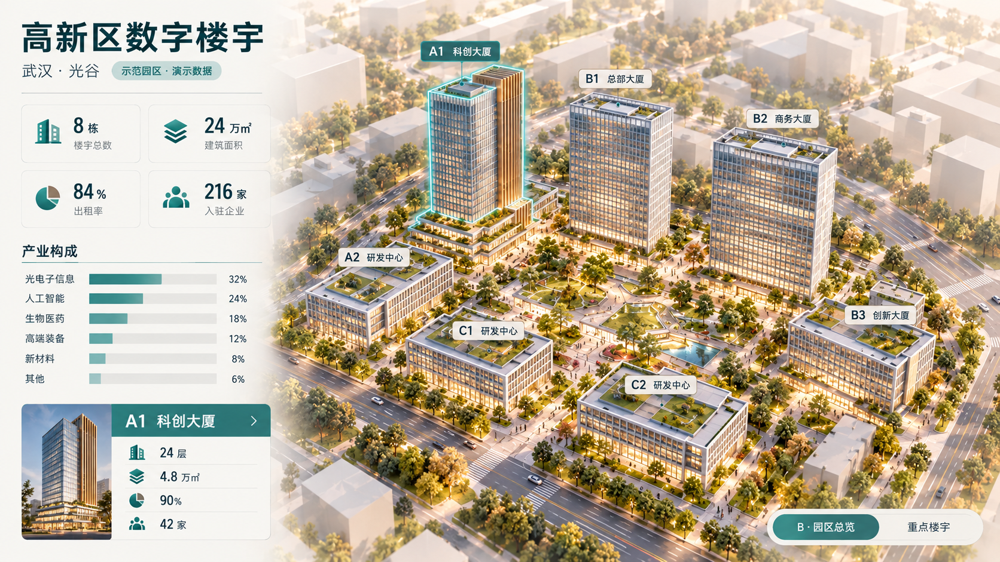
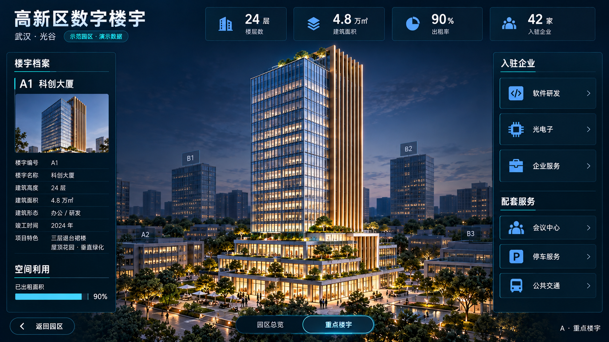
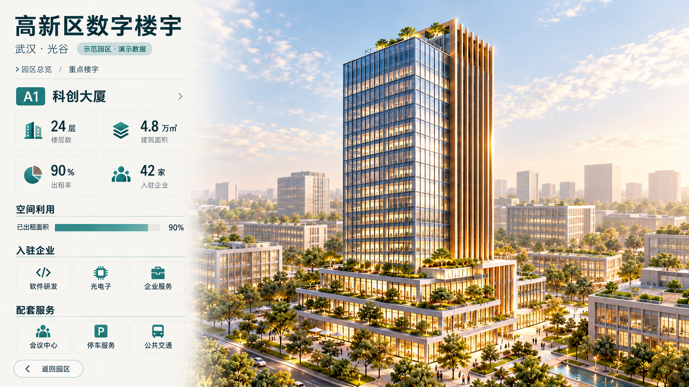

# A/B 概念图 v1 对照与审查

2026-10-15。实际产物来自内置 image_gen.imagegen，提示词、原始输出路径、参考依赖与哈希已归档。当前四图均为待用户确认；此文是审查记录，不是批准。

| 层级 | A 深色建筑沙盘 | B 浅色建筑展陈 |
| --- | --- | --- |
| 园区总览 |  |  |
| 重点楼宇 |  |  |

## 已观察到的表现

- A：夜景、深色底、中央景观与建筑为主体，顶部关键指标、左右业务栏形成整体态势阅读顺序。主要风险是侧栏信息较密、夜景和暖窗占比较高，需要控制层次和实现成本。
- B：日景、左侧集中信息、右侧建筑主视觉，园区与楼宇近景沿用同一阅读方向，适合讲解与建筑展陈。主要风险是天空及浅色建筑局部过亮，侧栏的小图表仍需按目标视距核对。
- A1 的青蓝玻璃、右侧古铜翼片、退台裙房和屋顶花园在四图中保有共同身份；相机、裙房细节和周边关系仍有生成漂移，尚未锁定工程几何。
- 四图均显示示范园区与演示数据标识；核心演示指标与规划源的园区/楼宇范围基本分开。

## 未关闭差异

| ID | 范围 | 实际差异 | 下一步 |
| --- | --- | --- | --- |
| C-01 | 园区对象 | 8栋KPI与列表已出现，但场景中明确标注仅见7个楼栋身份；C3未清楚呈现，不能据图片认定八栋关系齐全 | 选定风格后修订相机与对象布置，使八栋均可核对，统一形态后重新生成设计基准 |
| C-02 | 业务数据 | 总览的产业比例、部分楼名和楼层由AI补出，尚无规划口径；参考图不能新增业务事实 | 从统一对象与指标定义派生整屏数值，修订提示词再生成；不采用AI补充值作为数据源 |
| C-03 | 楼宇文字 | A近景出现“建筑高度：24层”及未核实竣工年份；空间利用条显示比例，应明确其分母是可租面积 | 整屏稿改为“楼层数”，去掉未定义字段；明确已租/可租面积与比例口径，复验文字与单位 |
| C-04 | 跨层形态 | 概念图中的可数层数、退台层级及周边楼栋位置未完全一致 | 在风格确认后，以一组固定建筑形态图补齐对应关系，再生成模型；不能直接把四张图各自解释成不同建筑 |

## 当前检查边界

实际PNG均为1672×941，接近16:9；目标应用画布为1920×1080。未拉伸图片冒充1080p交付。概念图用于风格和构图确认；最终整屏文字、每栋身份、图表、交互状态和运行性能还未验收。

用户下一次决定应指明选A或B、是否同时认可该方向的两层画面，以及希望修改的地方。若仅认可其中一层，不将其扩大为其他层批准。选择视觉方向不会自动关闭上述差异；修正后仍须核对设计基准。

当前停在concept，未登记任何passed概念确认，未开始整屏定稿、建模或前端开发。
